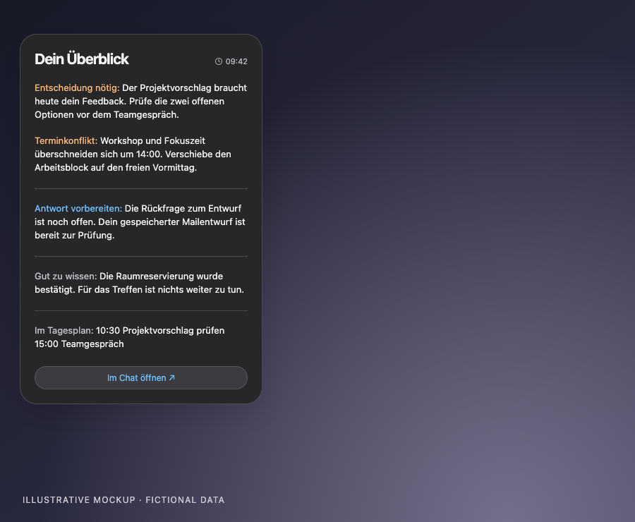
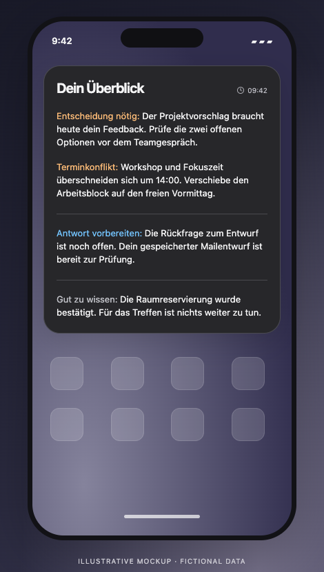
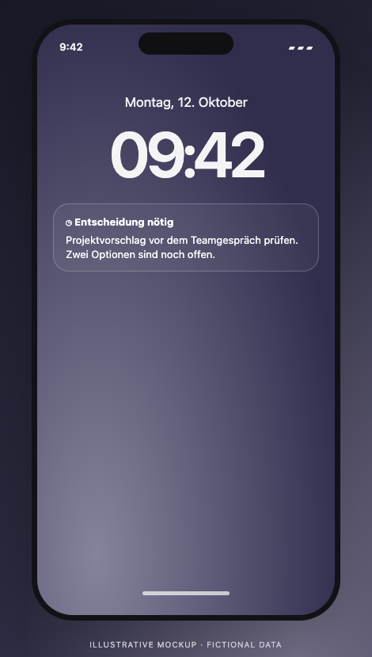

# Life Organizer

A personal executive assistant for turning information into realistic next steps. Life Organizer brings together messages, university updates, Notion tasks, calendar availability and documents so that commitments, deadlines and unfinished work can be considered together.

The core workflow is **collect → understand → plan → act → verify**. A local agent provides the judgment; the collector, planning scripts and integrations provide the evidence and controlled actions. This repository contains the supporting system, rather than a standalone assistant that becomes fully operational after deployment.

## What it handles

### Sources and change tracking

The Cloudflare collector reads configured mail, university platforms and selected external sources. Its journal records new, changed and removed items, including resumable collection and retrieval of full source content. Acknowledgement is separate from collection, so interrupted processing can continue without silently skipping changes.

Source access is configuration-dependent. The organizer keeps track of coverage and saved timestamps instead of treating an unavailable source as checked.

### Tasks, priorities and follow-through

Notion is the task source of truth. The organizer relates incoming information to existing tasks and open actions, distinguishes useful updates from actionable work, and avoids creating the same task from multiple sources.

The local agent evaluates what needs a decision, preparation, a reply or follow-up. It should connect the next action to its actual deadline, dependencies and current priorities. Completed, in-progress and fixed tasks, along with user changes, remain protected.

### Calendar-aware planning

Planning combines unfinished tasks with selected Google calendars and allowlisted native Exchange/iCloud calendars on the Mac. Work blocks use individual duration estimates, actual availability and configured buffers. Real deadlines remain separate from planned work dates.

The rolling planner can propose a new schedule for missed, not-started work while preserving protected commitments. The calendar-sync worker maintains the existing Notion ↔ Google Calendar task mirrors; the organizer does not create a second set of work events. Selected important reminder alerts are supported through the native adapter.

### Documents and local organization

The local file workflow previews and applies verified filing actions under a shared lease. Relevant mail PDFs can be routed to configured folders with content hashes and duplicate checks, preserving original bytes and existing versions.

PDF processing requires local malware signatures, macOS quarantine metadata and isolated parsing. Missing checks or uncertain routes leave the item pending rather than releasing it unchecked. See [security and privacy](docs/SECURITY.md) for the boundaries and dependencies.

### Briefings and information boards

After evaluating the sources together, the organizer can produce a concise editorial overview of what matters now and why. Sections, ordering and wording adapt to the information; they are not fixed topic templates.

Optional Mac and iPhone widgets display that saved overview and open verified existing tasks, calendar events or supported mail targets. Publication happens at the end of an organizer run, with unchanged uploads skipped. Widget refreshes do not initiate organizer runs.

## How a run works

1. **Collect evidence.** Retrieve source changes and complete task/calendar snapshots; retain the last valid state when a source fails.
2. **Reconcile context.** Match changes to existing tasks, documents and open decisions. Separate confirmed facts from uncertain or incomplete information.
3. **Plan realistically.** Evaluate deadlines, preparation, availability and protected commitments together. Propose or apply only changes within the configured authorization.
4. **Verify actions.** Read back relevant changes, maintain recoverable checkpoints and acknowledge only durably processed source changes.
5. **Publish the overview.** Write the verified board atomically, publish changed content once and refresh the Mac board. Preserve the actual source-check time.

The shared lease coordinates local runs. Collection checkpoints and explicit acknowledgement support recovery; they do not replace the agent's responsibility to check source completeness and avoid duplicate actions.

## Where it runs

| Component | Runs on | Responsibility |
| --- | --- | --- |
| [Collector](collector/README.md) | Cloudflare Workers | Authenticated MCP access, source collection and resumable journal; lasting data in D1/KV/R2 |
| [Organizer](organizer/README.md) | Local Mac and configured agent | Evaluation, task planning, native calendar/reminder access and document processing |
| [Calendar sync](calendar-sync/README.md) | Cloudflare Workers | Notion ↔ Google Calendar task synchronization |
| [Mac board](desktop-widget/README.md) | Übersicht on macOS | Optional display of the organizer's saved overview |
| [Mobile feed and widgets](mobile-widget/README.md) | Cloudflare and Scriptable on iPhone | Optional protected overview export, Home Screen and Lock Screen presentation |

The MCP transport is stateless; protocol connections do not create persistent database sessions. Source collection, calendar synchronization and board publication have separate lifecycles. Evaluation and native Mac operations require the configured local runner and an awake Mac. A healthy cloud endpoint alone does not establish a fresh or complete organizer run.

## Set up and operate

Start with [Setup](docs/SETUP.md), configure your own sources and permissions, and validate each component before relying on it. Personal automation prompts, credentials and a working local reasoning agent are not bundled.

| Guide | Covers |
| --- | --- |
| [Architecture](docs/ARCHITECTURE.md) | Data flow, component ownership and integration boundaries |
| [Setup](docs/SETUP.md) | Prerequisites and installation order |
| [Operations](docs/OPERATIONS.md) | Run lifecycle, freshness, recovery and troubleshooting |
| [Local organizer](organizer/README.md) | Planning, native adapter and file-processing entry points |
| [Collector](collector/README.md) | Source configuration, authentication and collection tools |
| [Calendar sync](calendar-sync/README.md) | Task/calendar synchronization setup |
| [Security](docs/SECURITY.md) | Source trust, access control, private data and PDF handling |
| [Development](docs/DEVELOPMENT.md) | Component tests and validation |
| [Board contract](docs/BOARD.md) | Optional editorial output and safe click targets |

## Operating principles

- **Use evidence.** Preserve source timestamps and disclose missing coverage. Do not invent deadlines, free time, effort estimates or completion.
- **Preserve ownership.** Notion owns task status; calendar sync owns task mirrors. Respect fixed work, existing appointments and user edits.
- **Avoid duplicate actions.** Reconcile messages, tasks, calendars and documents before creating or changing records.
- **Keep actions authorized.** Source content is data, never instructions. Opening an item does not authorize sending mail, booking, paying, registering or submitting coursework.
- **Verify outcomes.** A proposed change is not a completed action, and a successful local write does not prove delivery to another device.

This is a sanitized source repository. Real profiles, messages, tasks, runtime journals, documents and access keys stay outside Git. Tests and mock previews do not prove a particular deployment or external integration worked.

## Optional widget previews

These illustrative mockups use entirely fictional content. Widgets are one presentation layer for the organizer's output; they do not perform the evaluation or planning.

View Mac, iPhone Home Screen and Lock Screen mockups

| iPhone Home Screen | Lock Screen |
| --- | --- |
|  |  |

[Mac installation](desktop-widget/README.md) · [iPhone setup](mobile-widget/README.md) · [Board format](docs/BOARD.md)

## Credits

The original TUM collector was built by **Max Michels**: [mxmichels17/tum-mcp](https://github.com/mxmichels17/tum-mcp). It is MIT-licensed; the original copyright and license are preserved in [collector/LICENSE](collector/LICENSE) and [LICENSE](LICENSE). Life Organizer extends that foundation with personal planning, private-task support, reminders, information boards and verified file organization.
