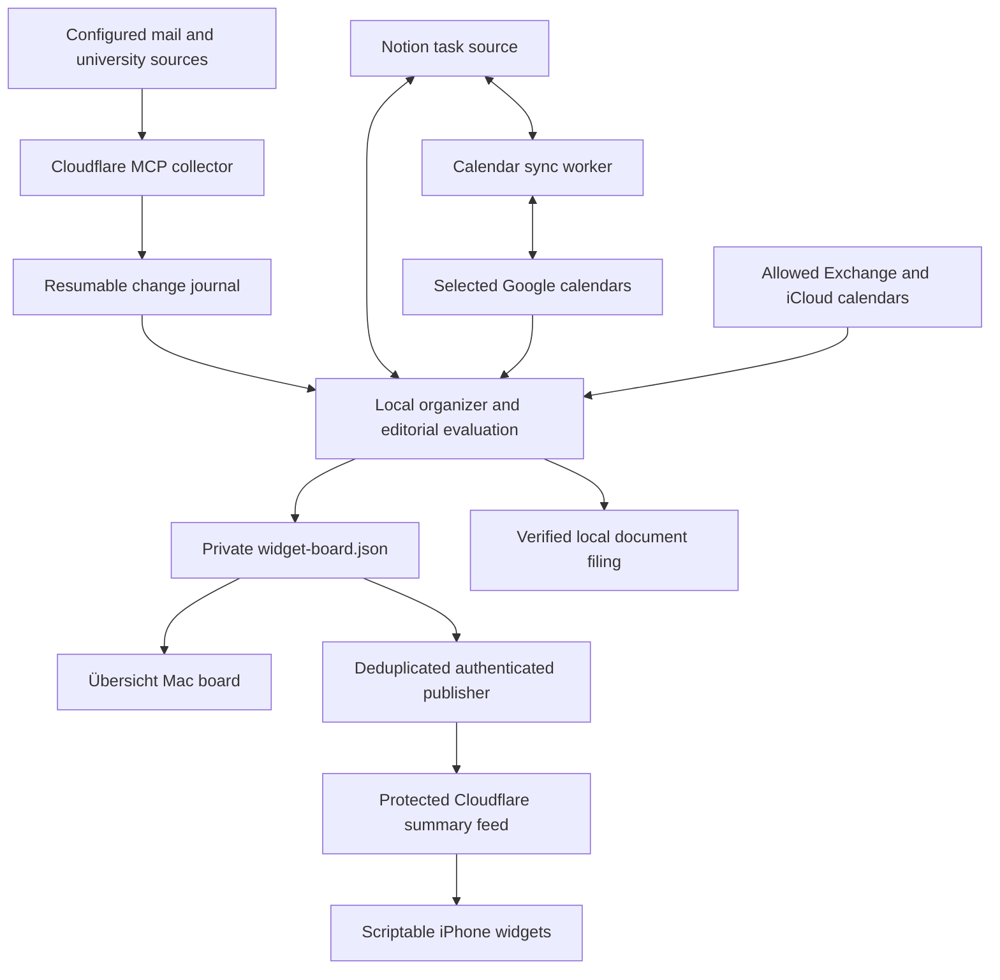

# Architecture

## Ownership

- **Collector:** reads configured sources and journals changes. Its existing API surface contains additional tools; read-only operating policy is not a claim that every tool is read-only.
- **Organizer:** evaluates complete source snapshots and calendars, preserves user decisions, prepares plans and writes editorial board data. An external local agent/runner supplies the judgment; these scripts do not call an LLM themselves.
- **Calendar sync:** owns task calendar mirrors. Do not create a second work event for the same Notion task.
- **Board renderers:** consume sections selected by the organizer. They do not invent categories, tasks or status summaries.
- **Publisher:** transfers only the compact board, using a writer key separate from the phone's reader key. A successful upload is not a fresh source check.

The Mac, cloud and phone have separate failure modes. A healthy feed can serve stale data; a successful Mac reminder write does not confirm iPhone delivery. Source timestamps and coverage must remain visible and truthful.
